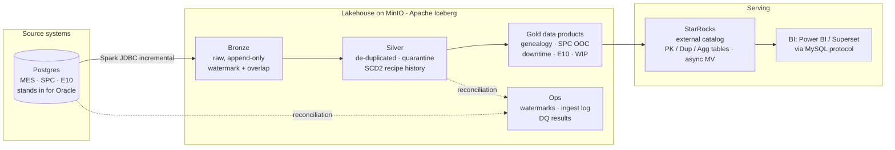

# Fab Lakehouse — trusted data products for a 200mm wafer fab, on an on-premise open-source lakehouse

**Problem.** In a wafer fab, process and equipment engineers spend hours pulling MES, SPC and equipment data
into Excel to answer questions like *"why is this chamber drifting, which lots are affected, and which recipe
version did they run?"* The data is spread across systems, duplicated, sometimes late or incomplete, and
nobody can prove the spreadsheet matches the source.

**This project** builds the platform that answers those questions from one place: a lakehouse on
**MinIO + Apache Iceberg**, with **PySpark** pipelines and **StarRocks** serving — the kind of stack a fab
runs on-premise for IP protection, OT/IT security and cost control. The whole platform runs on a laptop
with Docker Compose.

## Architecture



| Layer | Technology | Role |
|---|---|---|
| Source | PostgreSQL 16 | MES lot history, SPC, SEMI E10 equipment states, recipe master (current state only) |
| Storage | MinIO (S3 API, Chainguard build) | object storage for all table data; ILM on the raw landing bucket |
| Table format + catalog | Apache Iceberg, REST catalog | ACID tables, snapshots / time travel, schema evolution |
| Processing | PySpark 3.5 | incremental ingestion, MERGE upserts, SCD2, data products, data quality |
| Serving | StarRocks | MPP SQL over Iceberg in place + native Primary Key / Duplicate / Aggregate tables + async MV |

## Data products (gold)

| Product | Question it answers | Business use |
|---|---|---|
| `lot_genealogy` | Which tool, chamber and **recipe version** did each lot run at each step, and what did SPC measure? | Traceability for automotive customers; containment lists |
| `spc_ooc_daily` | Which chamber is out of control, and is it a sudden shift or a slow drift? | Excursion detection before more wafers are affected |
| `tool_downtime_episodes` | What takes tools down and for how long? | Downtime Pareto, PM planning |
| `tool_e10_daily` | Availability and utilization per tool per day (SEMI E10) | Capacity and OEE discussions |
| `wip_current` | Which lots are in process and how long have they been in the step? | Daily WIP / cycle-time review |

## Engineering highlights

- **Incremental ingestion** by high-watermark with a configurable **overlap window** to capture late-committed
  transactions; every run logged in `ops.ingest_log`.
- **Idempotent** silver MERGE on business keys — any job can be re-run after a failure without duplicates.
- **Realistic source problems injected** by the generator: MES double-logging, SPC points without a tool,
  late commits, recipe changes. Bad rows go to a **quarantine** table, never silently dropped.
- **SCD Type 2** recipe history built from a current-state-only source, used for point-in-time joins.
- **Reconciliation-based data quality** (8 checks, results stored for audit, non-zero exit on failure).
  Demonstrated: with no overlap window the *freshness* check still passes but *reconciliation* catches the
  lost row (see `docs/STEP_BY_STEP.md`, step 9).
- **StarRocks table models chosen by access pattern** + async materialized view for dashboards.
- **Lakehouse operations**: snapshot time travel, small-file compaction, snapshot expiry.

## Before vs After (estimated, illustrative)

| | Before (manual) | After (this platform) |
|---|---|---|
| Find which lots ran on a drifting chamber, with recipe version | 1–2 h of MES queries + Excel per excursion | one query, seconds |
| Weekly chamber SPC / OOC review | half a day of extraction and charting | refreshed table / MV, always current |
| Confidence the numbers match the source | none (spreadsheet copies) | automated reconciliation every run, audit table |
| Recipe version history | only current version in MES | full SCD2 history from first capture |

## Results

*(Add your query results / screenshots here — see `docs/STEP_BY_STEP.md` step 12.)*

Example from the synthetic data: chamber **ETCH01-B** shows poly CD mean drifting from ~180 nm to ~190 nm
over a week, with OOC rising from 0% to over 40% — a slow drift, caught from `gold.spc_ooc_daily`, with the
affected-lot list from `gold.lot_genealogy`.

## Run it

```bash
python3 generator/generate_fab_data.py --start 2026-11-01 --days 7 --out data/batch_01 --batch 1
docker compose up -d
./scripts/load_source.sh batch_01
./scripts/run_pipeline.sh
./scripts/starrocks.sh sql/starrocks/01_create_catalog.sql
./scripts/starrocks.sh sql/starrocks/02_explore_data_products.sql
```
Full walkthrough: **[docs/STEP_BY_STEP.md](docs/STEP_BY_STEP.md)** · Field-level rules:
**[docs/source_to_target_mapping.md](docs/source_to_target_mapping.md)**

## Repository layout

```
generator/   synthetic MES / SPC / E10 data generator (Python standard library only)
sql/source/  source schema + batch loader (upsert master data, append transactions)
jobs/        PySpark jobs: 01 bronze · 02 silver · 03 gold · 04 data quality · 05 Iceberg maintenance
sql/starrocks/  external catalog, analysis queries, serving layer (table models + MV)
scripts/     one-line wrappers for loading, running the pipeline, StarRocks prompt
docs/        step-by-step guide, source-to-target mapping
```

## Roadmap

Airflow orchestration · Debezium/Kafka CDC + StarRocks Routine Load · Trino federation ·
UCI SECOM sensor data as an FDC source with an anomaly model · OpenLineage lineage · Superset dashboard.

---
*All data is synthetic. Built by Benson Pang — 16 years in semiconductor manufacturing (STMicroelectronics, Micron),
data engineering on Databricks, MSc Data Science & AI.*
